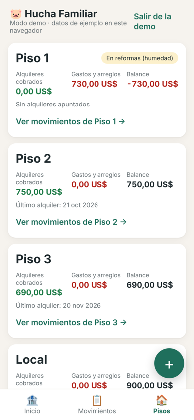

# 🐷 Hucha Familiar

App web para llevar las cuentas compartidas de un hogar entre dos personas: cobros, gastos y envíos entre dos cajas en monedas distintas (USD y EUR), con el cambio calculado de verdad.

[](https://lyn-devstack.github.io/hucha-familiar/?demo)

Se abre directamente con datos de ejemplo guardados en tu navegador, sin registrarte.

<p>
  
  
  
</p>

## Qué resuelve

Cuando el dinero de unos inmuebles se reparte entre dos países y dos monedas, es fácil perder la cuenta. La app responde en todo momento a:

- cuánto hay en cada caja, en su moneda,
- qué ha ingresado y qué ha gastado cada inmueble,
- en qué se ha gastado cada cosa, cuándo y quién lo apuntó.

## Funcionalidades

- **Dos cajas con su saldo:** una en USD y otra en EUR, más un total aproximado en euros con el último tipo de cambio.
- **Seis tipos de movimiento:** cobro de alquiler, gasto en cada caja, envío de una caja a la otra y ajustes o saldo inicial.
- **Envíos con tipo de cambio real:** apuntas lo que sale y lo que llega, y la app calcula el cambio aplicado.
- **Inmuebles:** cada uno con sus ingresos, gastos y balance.
- **Historial con filtros** por caja, tipo, inmueble, mes y texto del concepto.
- **Compartida y en tiempo real:** lo que apunta una persona aparece al momento en el móvil de la otra.
- **Pensada para el móvil:** botones grandes, teclado numérico, se puede instalar en la pantalla de inicio (PWA) y tiene modo oscuro.
- **Modo demo:** se puede probar sin cuenta con datos de ejemplo guardados en el navegador.

## Stack técnico

| Capa | Tecnología |
| --- | --- |
| Frontend | React 19, TypeScript y Vite |
| Backend | Supabase: PostgreSQL, Auth y Realtime |
| Seguridad | Row Level Security: solo los emails autorizados leen o escriben |
| Tests | Vitest (lógica de saldos, cambios y filtros) |
| CI/CD | GitHub Actions → lint, tests, build y despliegue en GitHub Pages |

### Decisiones de diseño

- **Céntimos enteros:** todos los cálculos se hacen en céntimos para evitar errores de coma flotante (`0.1 + 0.2`).
- **Repositorio intercambiable:** la interfaz `Repo` tiene dos implementaciones, `SupabaseRepo` (nube) y `LocalRepo` (demo en `localStorage`). La UI no sabe cuál está usando.
- **Lógica pura y testeada:** los saldos, los resúmenes por inmueble y los filtros están en `src/lib/ledger.ts`, sin dependencias de React.
- **Integridad en la base de datos:** un `CHECK` en PostgreSQL garantiza que cada tipo de movimiento lleve las cantidades correctas (por ejemplo, un envío siempre tiene importe en las dos monedas).

```
src/
├── components/   Pantallas: Inicio, Movimientos, Inmuebles, formulario y login
├── data/         Repo (interfaz), SupabaseRepo, LocalRepo y datos de demo
├── lib/          ledger.ts (saldos, filtros) y money.ts (formato, parseo)
├── constants.ts  Inmuebles y tipos de movimiento
└── types.ts
supabase/schema.sql   Tablas, restricciones y políticas RLS
```

## Ponerla en marcha

```bash
npm install
cp .env.example .env.local   # rellena la URL y la publishable key de Supabase
npm run dev
```

Sin `.env.local` la app arranca solo en modo demo.

### Configurar Supabase

1. En **SQL Editor**, pega `supabase/schema.sql`, cambia los emails de `family_members` y ejecútalo.
2. En **Authentication → Users → Add user**, crea un usuario por persona con *Auto Confirm User* marcado.
3. En **Authentication → Sign In / Providers**, desactiva *Allow new users to sign up*.

### Despliegue

Cada push a `main` pasa el lint y los tests y publica en GitHub Pages. Las credenciales de Supabase se configuran como **Variables** del repositorio (`VITE_SUPABASE_URL` y `VITE_SUPABASE_ANON_KEY`).

## Scripts

| Comando | Qué hace |
| --- | --- |
| `npm run dev` | Servidor de desarrollo |
| `npm test` | Tests con Vitest |
| `npm run lint` | Lint con oxlint |
| `npm run build` | Build de producción |
